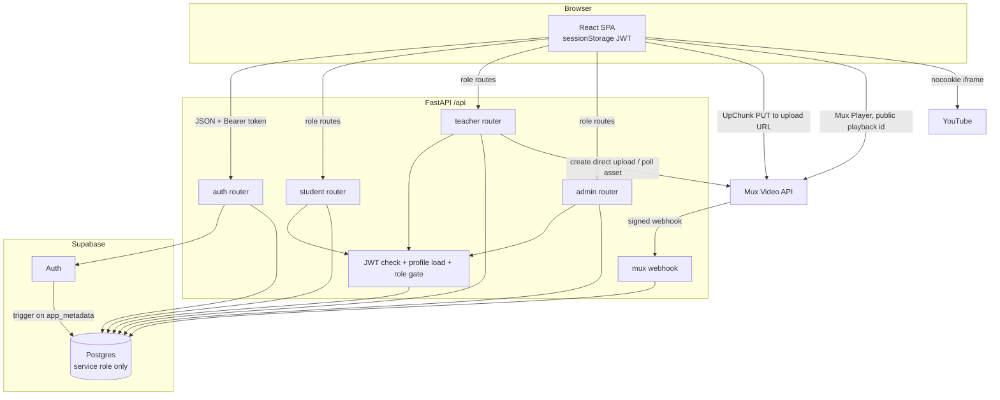
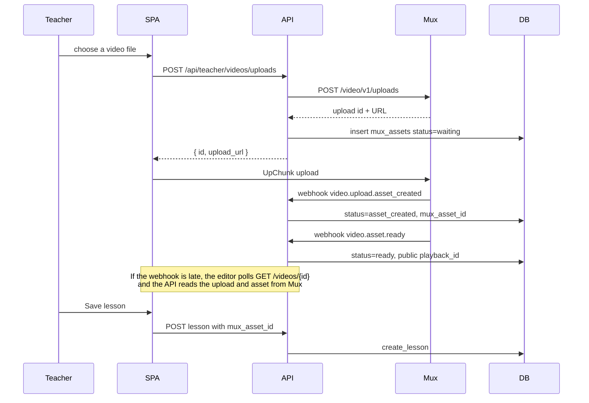

# Northstar LMS — system report

Northstar is a three-role learning system. A React app talks only to a FastAPI backend. The backend owns Supabase Auth and Postgres, and it integrates Mux for uploaded lesson video. A lesson can also point at a YouTube video. Each account has exactly one role: student, teacher, or admin.

This report describes the code as it is in this workspace: `backend/`, `supabase/migrations/`, and `frontend/`. The parent repository ignores `frontend/`. The UI is a separate git repo (`frontend/.git`, remote `https://github.com/striderr1o1/lms-frontend`).

## Overview

Teachers publish courses made of numbered lessons. A lesson has a title, Markdown notes, and at most one video, either a Mux asset or a YouTube id. Students enroll in active courses and then read lessons. Admins see counts and enrollment lists, and they approve every admin account after the first one.

The original sketch in `implementation.md` differs from the built schema. The shipped names are `enrollments` and `mux_assets`. Admin analytics are computed on read. Lesson notes are `title` plus `body`. Video is either `mux_asset_id` or `youtube_video_id`.

### Stack

| Layer | Choice |
| --- | --- |
| Frontend | React 19, Vite, React Router 7, plain JSX |
| Backend | Python, FastAPI, Uvicorn, Pydantic v2 |
| Auth and data | Supabase Auth and Postgres, via the Supabase Python client |
| Uploaded video | Mux Direct Uploads, webhooks, and `@mux/mux-player-react` |
| Linked video | YouTube URLs stored as an 11-character video id, embedded with `youtube-nocookie.com` |
| Notes | `react-markdown`, with raw HTML left disabled |

### How to run

Backend, from `backend/`, after applying `supabase/migrations/` in filename order:

```bash
python -m venv .venv
source .venv/bin/activate
pip install -r requirements.txt
cp .env.example .env
uvicorn app.main:app --host 127.0.0.1 --port 8000
```

Frontend, from `frontend/`:

```bash
npm install
cp .env.example .env
npm run dev
```

Vite’s default origin is `http://localhost:5173`, which matches `FRONTEND_ORIGIN`. The SPA reads `VITE_API_URL` (default `http://localhost:8000`).

| Variable | Where | Purpose |
| --- | --- | --- |
| `SUPABASE_URL` | backend | Project URL. Also the JWT issuer base (`/auth/v1`) |
| `SUPABASE_SECRET_KEY` | backend | Service-role key. Stays on the server |
| `SUPABASE_PUBLISHABLE_KEY` | backend | Password sign-in and refresh only |
| `FRONTEND_ORIGIN` | backend | Single CORS origin, and the Mux upload CORS origin |
| `MUX_TOKEN_ID`, `MUX_TOKEN_SECRET` | backend | Mux API credentials |
| `MUX_WEBHOOK_SECRET` | backend | Verifies `POST /api/webhooks/mux` |
| `VITE_API_URL` | frontend | FastAPI origin |

`GET /api/health` returns `{ "ok": true }`. Interactive docs are at `/docs`.

## Supported features

An account cannot act as more than one role. Sign-in must use the portal that matches `profiles.role`.

### Student

- Sign up and sign in on the student portal.
- See enrolled courses and a catalog of **active** courses.
- Enroll in an active course once. A second enroll returns “Already enrolled”.
- Open an enrolled course and read its lessons in lesson-number order.
- Watch a Mux video once the asset is `ready`, or a YouTube embed when the lesson stores a YouTube id.

There is no unenroll, progress tracking, comments, or quiz flow.

### Teacher

- Sign up and sign in on the teacher portal. Teacher signups are active immediately.
- Create a course (it starts `active`), rename it, mark it `active` or `inactive`, and delete it.
- Add, edit, and delete lessons. Delete renumbers the remaining lessons so numbers stay contiguous from 1.
- Attach one video per lesson:
  - upload a file through Mux, or
  - paste a YouTube URL.
- Poll Mux until the upload is `ready` or `errored`.

A teacher sees only their own courses. They do not see the student list for a course. That list is on the admin overview.

### Admin

- The first admin account is created with status `approved` and receives a session.
- Every later admin is stored as `pending`. Signup and sign-in return “Your admin account is waiting for approval” and do not return tokens.
- An approved admin can open the overview: student count, teacher count, course count, each teacher’s courses, and the usernames enrolled in each course.
- An approved admin can list pending admins and approve them. Approval does not send email. The new admin signs in afterward.

Admins do not create courses, edit lessons, or enroll anyone. There is no UI for the approved-admin list, though `GET /api/admin/admins?status=approved` exists.

### Shared

- Username: 3–32 characters, lowercase letters, digits, underscores.
- Password: 8–72 characters.
- Email is stored in Supabase Auth, not on `profiles`.
- Logout clears the browser session only.

## Architecture



Request path for a signed-in call:

1. The SPA sends `Authorization: Bearer <access_token>` to FastAPI.
2. FastAPI verifies the ES256 JWT against the project JWKS.
3. It loads `profiles` and the matching `students`, `teachers`, or `admins` row with the service-role client.
4. The route dependency requires the role. Admin routes also require `admins.status = approved`.
5. The service checks ownership (teacher owns the course or asset, student is enrolled) and then reads or writes Postgres.

The browser never uses the Supabase client. The publishable key is used only inside the API, for `sign_in_with_password` and `refresh_session`.

Code layout:

| Path | Role |
| --- | --- |
| `backend/app/main.py` | App, CORS, routers, validation errors |
| `backend/app/deps.py` | Current user and `require_role` |
| `backend/app/core/security.py` | JWKS verification |
| `backend/app/db.py` | Service-role client and error mapping |
| `backend/app/routers/` | HTTP routes |
| `backend/app/services/` | Auth, courses, lessons, enrollments, admin, Mux, YouTube parsing |
| `backend/app/schemas/` | Request and response models |
| `supabase/migrations/` | Schema, trigger, lesson RPCs |
| `frontend/src/api/` | `fetch` client per role |
| `frontend/src/pages/` | Screens |
| `frontend/src/components/` | Course cards, lesson editor, players |

## Backend

### Process and errors

- CORS allows one origin (`FRONTEND_ORIGIN`), methods `*`, and headers `Authorization` and `Content-Type`. Credentials are off because the SPA sends a bearer token, not cookies.
- Validation failures return `422` with `{ "detail": "<message>" }`. The handler uses the first Pydantic error and drops the `body` / `query` / `path` prefix.
- Postgres `23505` becomes `409`, `23503` and `P0002` become `404`, `23514` becomes `422`. Other database errors become `500` with a generic message. Details are logged, not returned.
- Route handlers are synchronous. The Mux webhook route is `async` only so it can read the raw body for the signature check.

### Auth

Signup (`auth_service.signup`):

1. Reject the username if `profiles.username` is already taken (`409`).
2. `auth.admin.create_user` with `email_confirm: true` and `app_metadata.role` plus `app_metadata.username`.
3. The database trigger writes `profiles` and the role row. If that row is missing, the API deletes the Auth user and returns `400`.
4. A pending admin gets `403` and no session. The Auth user and `admins` row stay in place.
5. Otherwise the API signs in with the password and returns tokens plus the profile.

Sign-in:

1. Password grant through a fresh publishable-key client.
2. Load `profiles`. Missing profile is `401`.
3. If `profiles.role` does not match the portal, `403` with `This account is registered as a {role}`.
4. Pending admins get `403` and no tokens.

Refresh exchanges the refresh token, reloads the profile, and again blocks pending admins.

`GET /api/auth/me` returns the profile for any valid token. It does not apply the admin-approval check. Pending admins are not issued tokens by signup or sign-in.

Tokens:

- Supabase access tokens, algorithm `ES256`, audience `authenticated`, issuer `{SUPABASE_URL}/auth/v1`.
- `role` inside the JWT must be the Supabase claim `authenticated`. The app role is **not** taken from the JWT. It is read from `profiles` on every request.
- `sub` must be a UUID. Clock leeway is 180 seconds.
- The SPA stores `access_token`, `refresh_token`, and the profile in `sessionStorage` (`lms_access_token`, `lms_refresh_token`, `lms_profile`). A `401` on an authenticated call refreshes once and retries once. Refresh failure clears storage and sends the browser to `/login`.

There is no logout endpoint, password reset, or email-verification step.

### Routes

All paths are under `/api`.

**Public**

| Method | Path | Body | Success |
| --- | --- | --- | --- |
| `GET` | `/health` | — | `{ "ok": true }` |
| `POST` | `/auth/signup` | `{ username, email, password, role }` | `201` auth payload |
| `POST` | `/auth/signin` | `{ email, password, role }` | auth payload |
| `POST` | `/auth/refresh` | `{ refresh_token }` | auth payload |
| `POST` | `/webhooks/mux` | Mux event, header `mux-signature` | `204` |

`role` is `student`, `teacher`, or `admin`.

Auth payload:

```json
{
  "access_token": "...",
  "refresh_token": "...",
  "token_type": "bearer",
  "expires_in": 3600,
  "profile": {
    "id": "<auth user uuid>",
    "username": "ada",
    "email": "ada@example.com",
    "role": "student",
    "admin_status": null
  }
}
```

`admin_status` is `pending` or `approved` for admins, and `null` otherwise.

**Authenticated**

| Method | Path | Role | Behavior |
| --- | --- | --- | --- |
| `GET` | `/auth/me` | any valid token | Current profile |

**Student** (`require_role("student")`)

| Method | Path | Behavior |
| --- | --- | --- |
| `GET` | `/student/courses` | Active courses, newest first, with `enrolled` and `lesson_count` |
| `GET` | `/student/courses/{course_id}` | Course plus lessons. Requires an enrollment row. `404` otherwise |
| `POST` | `/student/courses/{course_id}/enroll` | Enroll in an **active** course. `201` `{ course_id, enrolled_at }` |
| `GET` | `/student/enrollments` | Enrolled courses, newest enrollment first, including inactive courses |

A student lesson is `{ id, lesson_number, title, body, playback_id, youtube_video_id }`. `playback_id` is set only when the linked Mux asset has status `ready`.

**Teacher** (`require_role("teacher")`)

| Method | Path | Behavior |
| --- | --- | --- |
| `GET` | `/teacher/courses` | Caller’s courses, newest first |
| `POST` | `/teacher/courses` | `{ name }` → course, status `active` |
| `GET` | `/teacher/courses/{course_id}` | Course plus teacher lessons. Other teachers get `404` |
| `PATCH` | `/teacher/courses/{course_id}` | `{ name?, status? }` |
| `DELETE` | `/teacher/courses/{course_id}` | `204`. Cascades lessons and enrollments |
| `POST` | `/teacher/courses/{course_id}/lessons` | `{ title, body, mux_asset_id?, youtube_url? }` |
| `PATCH` | `/teacher/lessons/{lesson_id}` | `{ title?, body?, mux_asset_id?, youtube_url? }` |
| `DELETE` | `/teacher/lessons/{lesson_id}` | `204`, then renumber |
| `POST` | `/teacher/videos/uploads` | Creates a Mux direct upload and a `mux_assets` row |
| `GET` | `/teacher/videos/{video_id}` | `{ id, status, playback_id }` for the caller’s asset |

Teacher lessons add `mux_asset_id`, `video_status` (`waiting`, `asset_created`, `ready`, `errored`, or `null`), and `video_source` (`mux`, `youtube`, or `null`).

Lesson rules:

- Title 1–160 characters. Course name 1–120 characters. Body is a string and may be empty. Body has no maximum length.
- `youtube_url` is parsed to an id before save. The database stores the id, not the URL.
- A lesson cannot store both a Mux asset and a YouTube id. Sending a YouTube id clears `mux_asset_id`. Sending a Mux id clears `youtube_video_id`. Sending JSON `null` clears that side.
- The Mux asset must belong to the same teacher. Another teacher’s id is `404`.
- Lesson numbers are assigned in `public.create_lesson` as `max(lesson_number) + 1` while the course row is locked.

**Admin** (`require_role("admin")`, and `status = approved`)

| Method | Path | Behavior |
| --- | --- | --- |
| `GET` | `/admin/overview` | Counts plus teachers → courses → enrolled usernames |
| `GET` | `/admin/admins?status=pending\|approved` | Admin accounts. Default filter is `pending` |
| `POST` | `/admin/admins/{admin_id}/approve` | Sets `admins.status` to `approved` |

Overview shape:

```json
{
  "student_count": 0,
  "teacher_count": 0,
  "course_count": 0,
  "teachers": [
    {
      "teacher_id": "...",
      "username": "ada",
      "courses": [
        { "id": "...", "name": "Algebra", "status": "active", "students": ["bea"] }
      ]
    }
  ]
}
```

Counts include every row in `students`, `teachers`, and `courses` (inactive courses included). Admin accounts are not part of those three counts. Student names on a course are usernames, sorted. Email for the admin list is loaded with one Auth admin `get_user_by_id` call per row.

## Database

Migrations, in order:

1. `supabase/migrations/20261102130000_lms_init.sql` — tables, grants, RLS, signup function, lesson RPCs, insert trigger.
2. `supabase/migrations/20261102140000_signup_trigger_on_app_metadata.sql` — replaces the signup function and adds an update trigger. Supabase writes `raw_app_meta_data` after the user insert, so provisioning has to run on that update.
3. `supabase/migrations/20261103033000_lesson_youtube_video.sql` — `lessons.youtube_video_id` and a new `create_lesson` signature.

### Tables

```text
auth.users
    │
    │  id
    ▼
profiles (id = auth.users.id, username, role)
    │
    ├── students (profile_id unique)
    ├── teachers (profile_id unique)
    └── admins   (profile_id unique, status)

teachers
    ├── courses (teacher_id, name, status)
    │     ├── lessons (course_id, lesson_number, title, body, mux_asset_id, youtube_video_id)
    │     └── enrollments (student_id, course_id)
    └── mux_assets (teacher_id, upload_id, mux_asset_id, playback_id, status)

students ── enrollments
```

| Table | Columns | Notes |
| --- | --- | --- |
| `profiles` | `id` PK → `auth.users`, `username`, `role`, `created_at` | Username matches `^[a-z0-9_]{3,32}$`. Role is `student`, `teacher`, or `admin`. Unique index `profiles_username_key` |
| `students` | `id`, `profile_id` unique → `profiles`, `created_at` | |
| `teachers` | `id`, `profile_id` unique → `profiles`, `created_at` | |
| `admins` | `id`, `profile_id` unique → `profiles`, `status`, `created_at` | `pending` or `approved`. Partial index on pending rows |
| `courses` | `id`, `teacher_id` → `teachers`, `name`, `status`, `created_at` | Name length 1–120. Status `active` or `inactive`. Default `active` |
| `mux_assets` | `id`, `teacher_id` → `teachers`, `upload_id` unique, `mux_asset_id` unique, `playback_id`, `status`, `created_at` | Status `waiting`, `asset_created`, `ready`, `errored` |
| `lessons` | `id`, `course_id` → `courses`, `lesson_number`, `title`, `body`, `mux_asset_id` → `mux_assets`, `youtube_video_id`, `created_at` | Number `> 0`. Title length 1–160. Unique `(course_id, lesson_number)` **deferrable**. YouTube id is 11 characters from `[A-Za-z0-9_-]`, or null. Mux and YouTube cannot both be set |
| `enrollments` | `id`, `student_id` → `students`, `course_id` → `courses`, `enrolled_at` | Unique `(student_id, course_id)` |

Deletes cascade from `auth.users` to `profiles` to the role row, then to that role’s courses, lessons, and enrollments. Deleting a `mux_assets` row sets `lessons.mux_asset_id` to null. Deleting a course does not delete `mux_assets`, because those rows belong to the teacher.

There is no `updated_at`. Email is not a column. Admin analytics are not stored.

### App roles versus database roles

Application roles live in `profiles.role` and in the one-row role tables. They are not Postgres roles.

Postgres roles used by the schema:

| Role | Access |
| --- | --- |
| `anon`, `authenticated`, `public` | `REVOKE ALL` on every LMS table and on `private`. No policies grant them anything |
| `service_role` | `SELECT`, `INSERT`, `UPDATE`, `DELETE` on the seven public tables. `EXECUTE` on `create_lesson` and `delete_lesson`. This is the key the API uses |
| `supabase_auth_admin` | `USAGE` on schema `private` and `EXECUTE` on `private.handle_new_user()` |

### Row level security

RLS is **enabled and forced** on all seven public tables. The migrations create **no policies**.

With force RLS and no policies, `anon` and `authenticated` cannot read or write these tables through PostgREST. The API does not rely on RLS for “students see enrolled courses” or “teachers see their own courses”. Those checks are in the FastAPI services. `service_role` is what the backend uses, and in Supabase that role bypasses RLS.

If the service-role key leaked, RLS would not contain the damage. Authorization is only as strong as the route checks.

### Signup trigger

`private.handle_new_user()` is `SECURITY DEFINER` with an empty `search_path`.

Two triggers call it:

- `on_auth_user_created` — `AFTER INSERT` on `auth.users` (first migration; still present).
- `on_auth_user_app_meta` — `AFTER UPDATE OF raw_app_meta_data` (second migration). This is the one that actually provisions accounts, because Auth fills `app_metadata` on the update.

Behavior of the current function:

- If role or username in `raw_app_meta_data` is missing or invalid, it returns and does nothing.
- If a `profiles` row already exists, it returns and does not change the role.
- Otherwise it inserts `profiles` and one of `students`, `teachers`, or `admins`.
- For admins it takes transaction advisory lock `hashtext('lms_first_admin')`. If any admin is already `approved`, the new row is `pending`. Otherwise it is `approved`.

Role is fixed at signup. Nothing in the API updates `profiles.role`.

### Lesson functions

Both functions are `SECURITY INVOKER`, granted only to `service_role`.

`public.create_lesson(course, teacher, title, body, mux_asset_id, youtube_video_id)`:

- Locks the course row (`FOR UPDATE`).
- Raises `P0002` (`not found`) when the course is missing or owned by another teacher.
- Raises `P0002` when `mux_asset_id` is set and that asset is missing or owned by another teacher.
- Inserts the next lesson number and returns the new lesson id.
- YouTube shape and the “one video” rule are enforced by table checks, not by extra logic inside the function.

`public.delete_lesson(lesson, teacher)`:

- Locks the owning course and confirms the teacher.
- Deletes the lesson.
- Renumbers the rest with `row_number()` ordered by the old `lesson_number`.
- The unique pair is deferrable so the renumber can pass through temporary duplicates inside the statement.

## Frontend

Dark UI, gold accent (`#e2a54a` on `#16181d`). A sidebar shows the brand, username, role, and logout. Under 720px the sidebar stacks above the page. The main column is capped at 880px.

### Routing

| Path | Who | Screen |
| --- | --- | --- |
| `/login` | signed out | Three portal buttons: Student, Teacher, Admin |
| `/signup` | signed out | Username, email, password, role select |
| `/student` | student | Enrolled courses, then the active catalog |
| `/student/courses/:id` | student | Lessons |
| `/teacher` | teacher | Create form and own courses |
| `/teacher/courses/:id` | teacher | Rename and lesson editors |
| `/admin` | admin | Counts, teachers, pending admins |
| anything else | — | Home for the signed-in role, or `/login` |

`ProtectedRoute` waits until the auth bootstrap finishes, then redirects when the stored role does not match the route. The server still enforces the role. A forged `sessionStorage` profile cannot read another role’s data.

### State and API client

`AuthProvider` restores the profile from `sessionStorage`. If an access token exists, it calls `GET /api/auth/me` and stores the fresh profile. Login and signup call the API and then `saveSession`. Logout clears the three keys.

`frontend/src/api/client.js` is the only HTTP wrapper. It sends JSON, attaches the bearer token, and on `401` runs a single shared refresh. `204` becomes `null`. Error text comes from `detail`.

Role modules: `api/auth.js`, `api/student.js`, `api/teacher.js`, `api/admin.js`. Pages do not call `fetch` themselves.

### Screens

**Login.** Email and password, then a button per portal. The chosen role is sent as `role`. The form does not submit on Enter by itself. Each button triggers sign-in.

**Signup.** One form. A pending-admin `403` is shown as the server message. The page does not explain the approval rule before submit.

**Student home.** Loads enrollments and the catalog together. Enroll updates both lists. Catalog cards for courses the student already joined show Open instead of Enroll, so those courses appear in both sections.

**Student course.** Lessons sorted by `lesson_number`. Notes go through `MarkdownBody` (`react-markdown` only; the file comment forbids `rehype-raw`). Video is `LessonView`.

**Teacher home.** Create, activate/deactivate, delete with `window.confirm`.

**Teacher course.** Rename form, one blank `LessonEditor` for a new lesson, and one editor per saved lesson. Saving a new lesson remounts the draft and reloads the course.

**Admin.** Counts, one card per teacher, course names with enrolled usernames, then pending admins with Approve. Overview and the pending list load independently, so one can fail while the other renders.

### Lesson editor

Fields: title, Markdown notes, a video file input, and a YouTube URL.

- Choosing a video file aborts any in-flight UpChunk upload, clears the URL box, asks `POST /teacher/videos/uploads` for an upload URL, and uploads the file straight to Mux with UpChunk (`chunkSize` 5120, which UpChunk treats as kilobytes).
- While `video_status` is not `ready` or `errored`, the editor polls `GET /teacher/videos/{id}` every 3 seconds.
- YouTube preview uses the saved id, not the unsaved text, and only when a new Mux upload is not pending.
- Remove video / Keep video stages the change until Save.
- Save sends `title` and `body` plus a video patch from `videoPayload` (see Bugs).

## YouTube and Mux

A lesson has one video source or none. The check constraint `lessons_one_video_check` keeps `mux_asset_id` and `youtube_video_id` from both being set.



### Mux

`mux_service.create_upload` calls `https://api.mux.com/video/v1/uploads` with HTTP basic auth (`MUX_TOKEN_ID` / `MUX_TOKEN_SECRET`):

- `cors_origin` is `FRONTEND_ORIGIN` (required for the browser PUT).
- Upload URL timeout is 3600 seconds.
- New asset settings: `playback_policies: ["public"]`, `video_quality: "basic"`.

The API stores Mux’s upload id on `mux_assets.upload_id` and returns the **local** uuid as `id`. The SPA treats that uuid as `mux_asset_id` on the lesson. Mux’s own asset id arrives later and is stored in `mux_assets.mux_asset_id`.

Webhook `POST /api/webhooks/mux`:

- Requires `MUX_WEBHOOK_SECRET`.
- Parses `mux-signature` as `t=<unix>,v1=<hex>`.
- Rejects timestamps more than 300 seconds off.
- Checks HMAC-SHA256 of `timestamp + "." + raw body`. Multiple `v1` values are accepted so a rotated secret can match.
- Handles `video.upload.asset_created`, `video.asset.ready`, and `video.asset.errored`.
- `ready` copies the public playback id. Other event types are ignored. A valid signature with a bad JSON body still returns `204`.

`GET /teacher/videos/{id}` is the fallback when webhooks cannot reach localhost. If the row is not already `ready` or `errored`, the API reads the Mux upload and, once an asset id exists, the asset. `ready` stores the first playback id. `errored` on the **asset** sets `errored`.

Students receive `playback_id` only after `ready`, and only on an enrolled course. The player is `@mux/mux-player-react` with that public id. Playback is not signed. Anyone who has the id can request the stream from Mux.

### YouTube

Accepted inputs in `backend/app/services/youtube.py`:

- A raw 11-character id.
- `http` or `https` URLs on `youtube.com`, `m.youtube.com`, `youtu.be`, and `youtube-nocookie.com`.
- Paths: `/watch?v=`, `/embed/`, `/shorts/`, `/live/`, and `youtu.be/<id>`.
- Userinfo in the URL is rejected. `http` must be port 80 or default. `https` must be port 443 or default. `javascript:` and backslashes are rejected.

The id is what gets stored. The editor redisplays it as `https://www.youtube.com/watch?v=<id>`. Students and the teacher preview load:

`https://www.youtube-nocookie.com/embed/<id>`

The iframe allows accelerometer, autoplay, clipboard-write, encrypted-media, gyroscope, picture-in-picture, and web-share. The id is checked again in the browser against `^[A-Za-z0-9_-]{11}$` before it is placed in `src`.

`LessonView` renders the Mux player when `playback_id` is present, and otherwise the YouTube iframe. With neither id, it renders no video.

## Bugs and issues

### Defects

**Failed Mux uploads stay `waiting` and the editor polls forever.**  
The webhook handler updates state for `video.upload.asset_created`, `video.asset.ready`, and `video.asset.errored`. It ignores upload-level failures (`video.upload.errored`, `video.upload.cancelled`, timeouts). `get_video` only moves the row to `errored` when the Mux **asset** status is `errored`. An upload that never creates an asset stays `waiting`. `LessonEditor` polls every 3 seconds until status is `ready` or `errored`, so that screen never stops. A teacher can still save the lesson against that asset. Students then get no `playback_id` and no explanation.

**A new YouTube URL silently drops an in-progress Mux upload.**  
`videoPayload` in `LessonEditor.jsx` returns `{ youtube_url }` as soon as the typed URL looks new, and it does not send `mux_asset_id`. The UI also hides both previews in that overlap: Mux status is hidden because a URL is being typed, and the YouTube preview is hidden because a Mux id is pending. Save attaches YouTube only. The `mux_assets` row and the Mux upload are left behind.

**Students get a blank video area while Mux is processing.**  
`playback_id` is omitted until `ready`. `LessonView` then tries YouTube, which returns nothing when `youtube_video_id` is null. The page shows the notes and no “video is processing” state. The teacher view is the only place that shows `video_status`.

**The lesson editor never previews Mux.**  
`MuxPlayer` is used only in `LessonView`. After an upload is `ready`, the teacher still sees the status string, not the player. YouTube is the only inline preview.

### Access and security

**Deactivating a course blocks new enrollment and hides the catalog card. It does not remove existing access.**  
`list_catalog` and `enroll` require `status = active`. `get_student_course` checks the enrollment row only. An enrolled student can still open the course, read notes, and receive a public playback id after the teacher marks the course inactive. Enrollments are listed with the inactive status visible.

**Mux playback is public.**  
Uploads are created with `playback_policies: ["public"]`. The API hides the id from students who are not enrolled, and hides it until the asset is ready. The id itself is not a capability token. A copied id plays outside the LMS.

**Wrong-portal sign-in reveals the real role.**  
A correct password with the wrong portal returns `403` and `This account is registered as a student` (or teacher, or admin). The password check has already succeeded by then. The tokens are not returned to the client.

**Logout does not revoke tokens.**  
The SPA deletes `sessionStorage`. The access token and refresh token stay valid until they expire. There is no server logout.

**Teacher and student registration is open.**  
Only admins wait for approval. Anyone who can reach the API can create a teacher, publish courses, and upload video to the Mux account on the server. `email_confirm` is set to true, so there is no mailbox check.

**Pending-admin signup looks like a failed registration.**  
The user, profile, and `admins` row are committed, then the API returns `403`. A second signup for the same email returns “Email is already registered”, which hides the fact that the first attempt did create an account that is waiting for approval.

**Authorization lives entirely in FastAPI.**  
That matches the design (forced RLS, no policies, no grants for `anon` or `authenticated`). It is also a single point of failure: every new route has to call `require_role` and an ownership check. The service-role key bypasses RLS.

**Passwords are limited to 72 characters, while bcrypt’s limit is 72 bytes.**  
Non-ASCII passwords can pass Pydantic and still be rejected or truncated by Auth.

**Lesson Markdown has no size cap.**  
`body` is an unbounded `text` column. `react-markdown` does not render raw HTML. Remote images and links in notes still load from the student’s browser.

### Product gaps

- No unenroll, lesson reorder, course duplication, or teacher view of enrolled students.
- No password reset, email change, or session list.
- No pagination. Admin overview loads every teacher, course, and enrollment.
- Admin approval has no notification. The approved list has an API and no screen.
- Catalog repeats courses that are already in “Your courses”.
- Deleting a lesson renumbers later lessons, so “lesson 3” can become “lesson 2”.
- Deleting a course, deleting a lesson, or clearing a video does not delete the Mux asset or the `mux_assets` row. Uploads that are never saved onto a lesson are also left behind. Mux storage keeps growing.
- `GET /api/health` does not touch Postgres or Mux.
- Local webhook delivery needs a public URL. Polling covers the success path while the editor is open. It does not cover upload failures, as described above.
- YouTube hosts and shapes outside the parser (`music.youtube.com`, extra path segments, `/v/<id>`) are rejected as an invalid URL.
- There are no automated tests in the backend or the frontend.

### Repository and docs

- The parent `.gitignore` ignores `frontend/`. Cloning this repo does not include the UI. The UI has its own `.git` and GitHub remote.
- `README.md` documents the API and Mux only. It does not mention YouTube, `youtube_url`, or how to run the SPA. The lesson-create example omits `youtube_url`.
- `frontend/README.md` is still the Vite template text.
- `implementation.md` is the original sketch (different table names, analytics stored on the admin row, a single `video_url`). The migrations and services are the source of truth.
